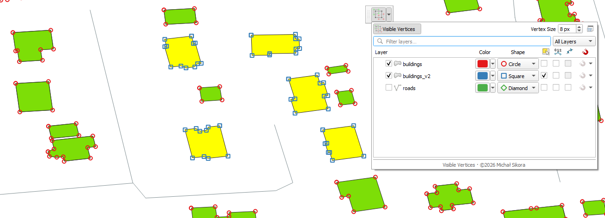
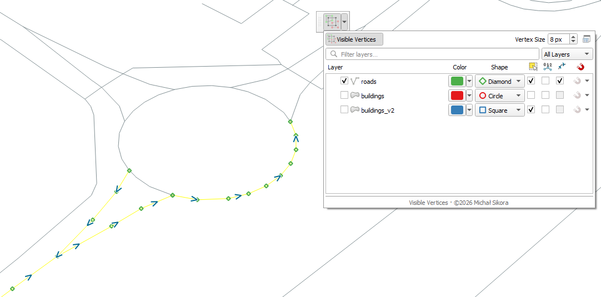
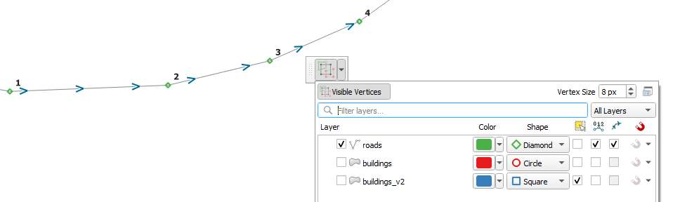
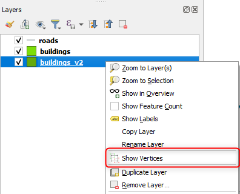
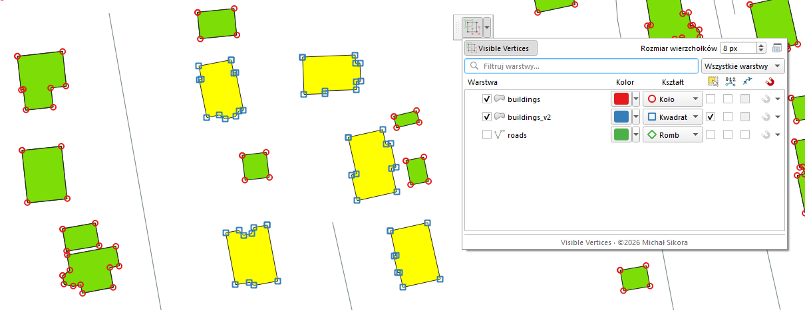
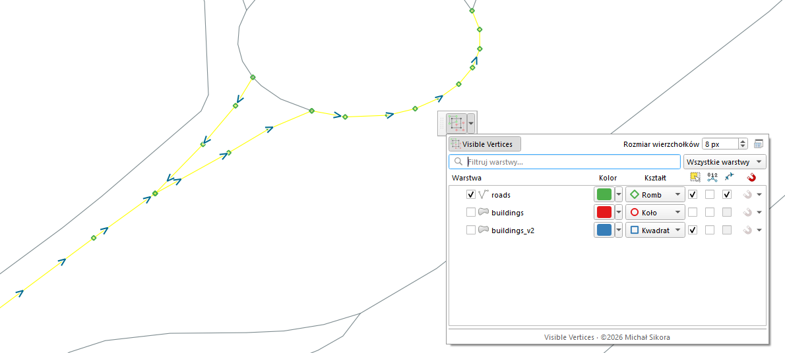
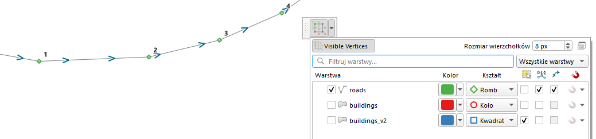
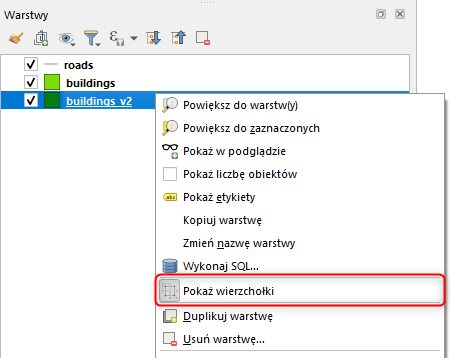

# Visible Vertices

## [EN]/[PL]

## [EN] Visible Vertices

**Visible Vertices** displays vertices, vertex indices and line directions from multiple reference vector layers directly on the QGIS map canvas. Each layer has independent display settings, so you can inspect geometry and use reference vertices while working on another layer.

Overlays work independently of source-layer visibility and edit mode. They do not change geometry, attributes, symbology or labeling. Snapping controls update the native QGIS project snapping configuration.

---

## VERSION 1.0.0

- Reference vertex overlays for multiple point, line and polygon layers.
- Individual marker colors and shapes, with a shared marker size.
- Zero-based vertex indices and line-direction arrows, independent of markers.
- A selected-features-only display filter for each layer.
- Native per-layer snapping controls with selectable snapping types.
- A toolbar popup and a dockable panel with shared display settings.
- Layer display configuration stored in the QGIS project.

The panel opens from the arrow next to the toolbar button. Use **Dock panel** to dock it in the QGIS window.

---

## FEATURES AND INTERFACE

The toolbar button switches all overlays on or off without clearing layer settings. Its arrow opens the configuration popup. Use **Dock panel** in the popup or **Plugins → Visible Vertices → Visible Vertices Panel** to open the dockable panel.

| Control | Purpose |
| --- | --- |
| Layer checkbox | Show or hide vertex markers for this layer. |
| Color / Shape | Set the layer color and marker shape: circle, square, diamond, cross or X. |
| Selected features only | Limit markers, indices and directions to this layer's selected features. Without a selection, these overlays are empty. |
| Show index | Display actual vertex indices starting at 0 for each feature, continuing through its parts and rings. |
| Show line direction | Display arrows following stored geometry order; available only for line layers. |
| Magnet / magnet arrow | Toggle native snapping for the layer / choose its snapping types. |
| Vertex Size | Set a shared marker size from 3 to 25 screen pixels. |
| Search / All layers / Visible layers | Filter the layer list by name and visibility in the QGIS layer tree, including parent-group visibility. |

List filtering does not change overlays or layer settings. Layers with markers, indices or directions enabled appear first. Changing the active QGIS layer does not change the reference-layer configuration.

Markers, indices and arrows work independently: you can display indices or directions without markers. Enabling any of them also enables the main overlay switch. Turning that switch off hides all three visualizations; snapping has separate controls.

---

## INSTALLATION

### Install from ZIP

1. Obtain the plugin ZIP containing the `visible_vertices` folder.
2. Open **Plugins → Manage and Install Plugins → Install from ZIP** in QGIS.
3. Select the ZIP and install it, then enable **Visible Vertices** in the installed plugins list if necessary.
4. Open the panel using the arrow next to the button on the **Visible Vertices** toolbar.

### Manual installation

1. Open **Settings → User Profiles → Open Active Profile Folder** in QGIS.
2. Copy the `visible_vertices` folder into that profile's `python/plugins` directory.
3. Restart QGIS and enable the plugin.

For the default Windows profile, use:

- QGIS 3: `%APPDATA%\QGIS\QGIS3\profiles\default\python\plugins`
- QGIS 4: `%APPDATA%\QGIS\QGIS4\profiles\default\python\plugins`

Use the same plugin files in both versions. After replacing an installation, disable and re-enable the plugin or restart QGIS.

**Project links:** [Source code and documentation](https://github.com/michal-k-sikora/qgis-visible-vertices) · [Issue tracker](https://github.com/michal-k-sikora/qgis-visible-vertices/issues).

---

## REQUIREMENTS

- Declared QGIS range: **3.40–4.99**.
- Python and Qt provided by QGIS; Qt imports use `qgis.PyQt`.
- At least one spatial vector layer in the project to display reference geometry.

---

## USAGE

1. Load your working layer and reference vector layers into the project.
2. Open the Visible Vertices popup or dockable panel.
3. Find the reference layers and enable their vertex checkboxes. Choose colors, shapes and marker size.
4. Optionally enable **Show index**, **Show line direction** or **Selected features only** for each layer.
5. Activate the working layer and inspect or edit it with the reference overlays visible. Reference layers can remain outside edit mode and hidden in the layer tree.
6. If needed, enable the magnet for a reference layer and choose snapping types from its arrow menu.
7. Use the main toolbar button to temporarily hide or show overlays. Save the QGIS project to preserve the layer display configuration.

Vertex markers and direction arrows limited to a selected line feature.

Vertex indices and direction arrows displayed together on a line.

You can also select one or more spatial vector layers in the Layers panel and use **Show Vertices** from the context menu to toggle their markers.

### Snapping

The magnet operates through QGIS snapping; drawing markers does not enable snapping by itself. The menu offers **Vertex**, **Segment**, **Middle of Segments**, **Centroid** and **Area**, which can be combined.

Per-layer snapping requires **Advanced Configuration**. If the project uses another mode, the plugin asks before switching it. Enabling a layer or adding a snapping type also enables project snapping. Existing layer tolerances, units and other snapping options are preserved; a new layer entry inherits the project tolerance and units. Disabling the magnet keeps the stored types. Removing the last type disables that layer's snapping entry.

The selected-features filter affects overlays only. Snapping follows native QGIS configuration, independently of this display filter. Turning off the main overlay button leaves snapping settings in place.

---

## EXAMPLES

- Compare reference vertices across several layers while digitizing another layer.
- Inspect multipart geometry and polygon-ring vertex order using indices.
- Check the stored direction of line features.
- Inspect selected features without overlays for the entire layer.

## CONFIGURATION AND DISPLAY LIMITS

The QGIS project stores each layer's marker visibility, color, shape, selection filter, indices and directions, plus the shared marker size, layer-visibility filter and dock-open state. Native snapping settings are also part of the project. The main overlay switch is a runtime setting; after restarting QGIS, enable it to show configured overlays.

Overlays refresh after geometry edits, selection changes, panning, zooming, map rotation and CRS changes. Indices follow actual geometry vertices, including curve control vertices and closing ring vertices. Coincident vertices of a feature can share a label such as `0, 4`. Line arrows indicate geometry order, not a directional attribute such as traffic flow.

For dense datasets, zoom in. Above 50,000 collected marker vertices per layer in the current view, that layer's markers are hidden and its row shows a warning. Indices and arrows have separate limits of 10,000 labels and 10,000 arrows per layer per refresh, with a 250,000-source-vertex scan budget. Reaching these decoration limits produces a partial display and a warning in the QGIS log under **Visible Vertices**. Dense index labels may overlap.

## AUTHOR AND LICENSE

**Michał Sikora**  
Contact: **michal.k.sikora@gmail.com**  
License: GNU GPL version 2; see [LICENSE](LICENSE).

---

## [PL] Visible Vertices

**Visible Vertices** wyświetla wierzchołki, ich indeksy i kierunki linii z wielu referencyjnych warstw wektorowych bezpośrednio na mapie QGIS. Każda warstwa ma niezależne ustawienia wyświetlania, co ułatwia kontrolę geometrii i korzystanie z wierzchołków referencyjnych podczas pracy na innej warstwie.

Nakładki działają niezależnie od widoczności warstw źródłowych i trybu edycji. Nie zmieniają geometrii, atrybutów, symboliki ani etykietowania. Przyciski przyciągania zmieniają natywną konfigurację snappingu projektu QGIS.

---

## WERSJA 1.0.0

- Nakładki wierzchołków wielu referencyjnych warstw punktowych, liniowych i poligonowych.
- Osobny kolor i kształt markerów dla każdej warstwy oraz wspólny rozmiar markerów.
- Indeksy wierzchołków od 0 i strzałki kierunku linii działające niezależnie od markerów.
- Filtr wyświetlania tylko zaznaczonych obiektów dla każdej warstwy.
- Natywne przyciąganie dla poszczególnych warstw z wyborem typów.
- Panel rozwijany i dokowalny ze wspólnymi ustawieniami wizualizacji.
- Konfiguracja wyświetlania warstw zapisywana w projekcie QGIS.

Panel rozwijany otwierany strzałką obok przycisku na pasku narzędzi. Przycisk dokowania pozwala zadokować go w oknie QGIS.

---

## FUNKCJE I INTERFEJS

Przycisk na pasku narzędzi włącza lub wyłącza wszystkie nakładki bez kasowania ustawień warstw. Strzałka obok otwiera panel konfiguracji. Przycisk dokowania w panelu rozwijanym lub pozycja panelu w menu **Wtyczki → Visible Vertices** otwiera panel dokowalny.

| Kontrolka | Działanie |
| --- | --- |
| Checkbox przy nazwie warstwy | Pokazuje lub ukrywa markery wierzchołków tej warstwy. |
| Kolor / Kształt | Ustawia kolor warstwy i kształt markerów: koło, kwadrat, romb, krzyż lub X. |
| Tylko zaznaczone obiekty | Ogranicza markery, indeksy i kierunki do zaznaczonych obiektów tej warstwy. Bez zaznaczenia nakładki są puste. |
| Wyświetl indeks | Pokazuje rzeczywiste indeksy wierzchołków od 0 dla każdego obiektu, kolejno przez części i pierścienie. |
| Pokaż kierunek linii | Pokazuje strzałki zgodne z kolejnością zapisanej geometrii; dostępne tylko dla warstw liniowych. |
| Magnes / strzałka magnesu | Włącza przyciąganie dla warstwy / pozwala wybrać typy przyciągania. |
| Rozmiar wierzchołków | Ustawia wspólny rozmiar markerów od 3 do 25 pikseli ekranowych. |
| Wyszukiwanie / Wszystkie warstwy / Widoczne warstwy | Filtruje listę po nazwie i widoczności w drzewie QGIS, z uwzględnieniem grup nadrzędnych. |

Filtrowanie listy nie zmienia nakładek ani ustawień warstw. Warstwy z włączonymi markerami, indeksami lub kierunkami pojawiają się na początku. Zmiana aktywnej warstwy QGIS nie zmienia konfiguracji warstw referencyjnych.

Markery, indeksy i strzałki działają niezależnie: można wyświetlać indeksy lub kierunki bez markerów. Włączenie dowolnej z tych opcji włącza też główny przełącznik nakładek. Wyłączenie przełącznika ukrywa wszystkie trzy wizualizacje; przyciąganie ma osobne sterowanie.

---

## INSTALACJA

### Instalacja z ZIP

1. Przygotuj archiwum ZIP wtyczki zawierające folder `visible_vertices`.
2. W QGIS otwórz **Wtyczki → Zarządzanie wtyczkami → Zainstaluj z pliku ZIP**.
3. Wskaż ZIP i zainstaluj wtyczkę, a następnie w razie potrzeby włącz **Visible Vertices** na liście zainstalowanych wtyczek.
4. Otwórz panel strzałką obok przycisku na pasku **Visible Vertices**.

### Instalacja ręczna

1. W QGIS wybierz **Ustawienia → Profile użytkownika → Otwórz katalog aktywnego profilu**.
2. Skopiuj folder `visible_vertices` do podkatalogu `python/plugins` tego profilu.
3. Uruchom QGIS ponownie i włącz wtyczkę.

Dla domyślnego profilu w Windows są to katalogi:

- QGIS 3: `%APPDATA%\QGIS\QGIS3\profiles\default\python\plugins`
- QGIS 4: `%APPDATA%\QGIS\QGIS4\profiles\default\python\plugins`

W obu wersjach używaj tych samych plików wtyczki. Po zastąpieniu instalacji wyłącz i ponownie włącz wtyczkę lub uruchom QGIS ponownie.

**Adresy projektu:** [Kod źródłowy i dokumentacja](https://github.com/michal-k-sikora/qgis-visible-vertices) · [Zgłoszenia błędów](https://github.com/michal-k-sikora/qgis-visible-vertices/issues).

---

## WYMAGANIA

- Deklarowany zakres QGIS: **3.40–4.99**.
- Python i Qt dostarczane z QGIS; importy Qt przez `qgis.PyQt`.
- Co najmniej jedna przestrzenna warstwa wektorowa w projekcie, aby wyświetlić geometrię referencyjną.

---

## JAK UŻYWAĆ WTYCZKI

1. Wczytaj do projektu warstwę roboczą i referencyjne warstwy wektorowe.
2. Otwórz panel rozwijany lub dokowalny Visible Vertices.
3. Wyszukaj warstwy referencyjne i zaznacz przy nich checkboxy wierzchołków. Dobierz kolory, kształty i rozmiar markerów.
4. Opcjonalnie włącz **Wyświetl indeks**, **Pokaż kierunek linii** lub **Tylko zaznaczone obiekty** dla poszczególnych warstw.
5. Uaktywnij warstwę roboczą i kontynuuj kontrolę lub edycję z widocznymi nakładkami referencyjnymi. Warstwy referencyjne mogą pozostać poza trybem edycji i być ukryte w drzewie warstw.
6. W razie potrzeby włącz magnes dla warstwy referencyjnej i wybierz typy przyciągania z menu jego strzałki.
7. Głównym przyciskiem na pasku tymczasowo ukrywaj lub pokazuj nakładki. Zapisz projekt QGIS, aby zachować konfigurację wyświetlania warstw.

Markery wierzchołków i strzałki kierunku ograniczone do zaznaczonego obiektu liniowego.

Indeksy wierzchołków i strzałki kierunku wyświetlane jednocześnie na linii.

Możesz też zaznaczyć jedną lub kilka przestrzennych warstw wektorowych w panelu Warstwy i przełączyć ich markery poleceniem **Pokaż wierzchołki** z menu kontekstowego.

### Przyciąganie

Magnes korzysta ze snappingu QGIS; samo wyświetlenie markerów nie włącza przyciągania. Menu pozwala łączyć typy: **Wierzchołek**, **Segment**, **Środek segmentów**, **Centroid** i **Obszar**.

Przyciąganie dla poszczególnych warstw wymaga **Konfiguracji zaawansowanej**. Jeżeli projekt używa innego trybu, wtyczka pyta przed jego zmianą. Włączenie warstwy lub dodanie typu przyciągania włącza też snapping projektu. Istniejące tolerancje warstw, jednostki i pozostałe opcje są zachowywane; nowy wpis warstwy przejmuje tolerancję i jednostki projektu. Wyłączenie magnesu zachowuje zapisane typy. Usunięcie ostatniego typu wyłącza wpis przyciągania tej warstwy.

Filtr zaznaczonych obiektów ogranicza wyłącznie nakładki. Przyciąganie działa według natywnej konfiguracji QGIS, niezależnie od tego filtra wyświetlania. Wyłączenie głównego przycisku nakładek zachowuje ustawienia snappingu.

---

## PRZYKŁADY ZASTOSOWAŃ

- Porównywanie wierzchołków kilku warstw referencyjnych podczas digitalizacji innej warstwy.
- Kontrola geometrii wieloczęściowej i kolejności wierzchołków pierścieni poligonów przy użyciu indeksów.
- Sprawdzanie kierunku zapisanej geometrii obiektów liniowych.
- Kontrola zaznaczonych obiektów bez nakładek całej warstwy.

## KONFIGURACJA I OGRANICZENIA WYŚWIETLANIA

Projekt QGIS przechowuje widoczność markerów, kolor, kształt, filtr zaznaczenia, indeksy i kierunki każdej warstwy oraz wspólny rozmiar markerów, filtr widoczności listy i stan otwarcia panelu dokowalnego. Natywne ustawienia snappingu także należą do projektu. Główny przełącznik nakładek działa w bieżącej sesji; po ponownym uruchomieniu QGIS włącz go, aby pokazać skonfigurowane nakładki.

Nakładki odświeżają się po edycji geometrii, zmianie zaznaczenia, przesuwaniu, skalowaniu, obrocie mapy i zmianie CRS. Indeksy odpowiadają rzeczywistym wierzchołkom geometrii, w tym punktom kontrolnym krzywych i wierzchołkom zamykającym pierścienie. Wspólna pozycja wierzchołków obiektu może otrzymać etykietę taką jak `0, 4`. Strzałki pokazują kolejność geometrii, a nie atrybut kierunkowy, taki jak kierunek ruchu drogowego.

Przy gęstych danych przybliż widok. Powyżej 50 000 zebranych wierzchołków markerów jednej warstwy w bieżącym widoku jej markery są ukrywane, a w wierszu pojawia się ostrzeżenie. Indeksy i strzałki mają osobne limity 10 000 etykiet i 10 000 strzałek na warstwę i odświeżenie oraz budżet skanowania 250 000 źródłowych wierzchołków. Osiągnięcie tych limitów dekoracji powoduje częściowe wyświetlenie i ostrzeżenie w dzienniku QGIS, w zakładce **Visible Vertices**. Przy dużym zagęszczeniu etykiety indeksów mogą na siebie nachodzić.

## AUTOR I LICENCJA

**Michał Sikora**  
Kontakt: **michal.k.sikora@gmail.com**  
Licencja: GNU GPL w wersji 2; zobacz [LICENSE](LICENSE).
